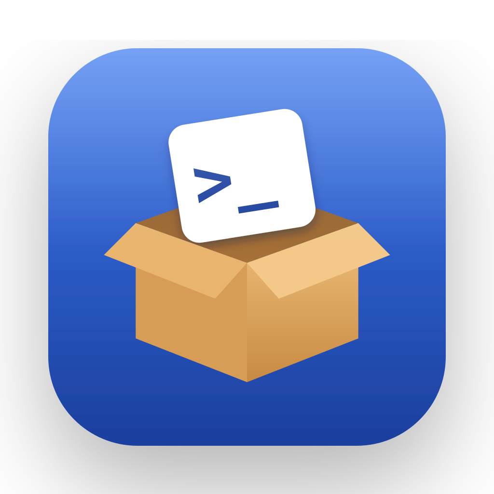
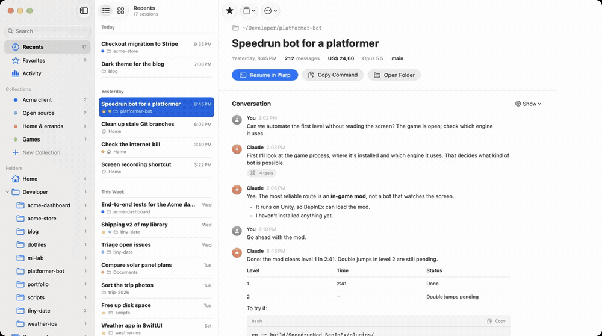
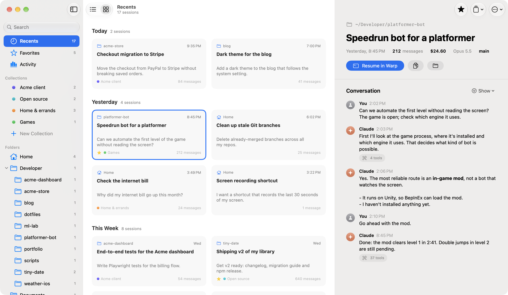
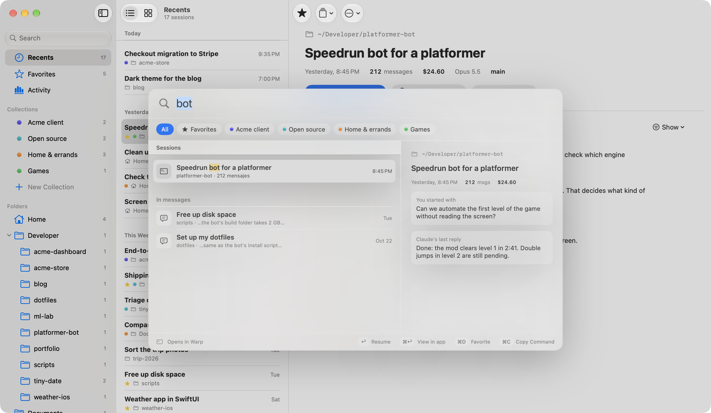
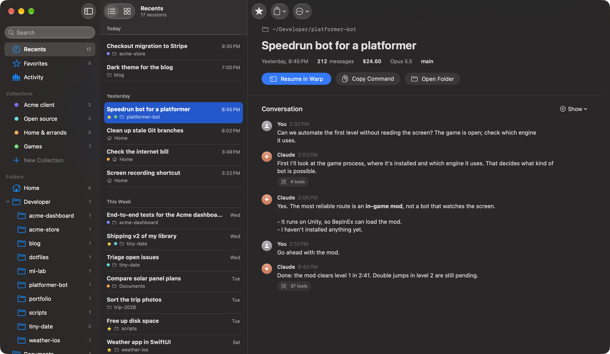
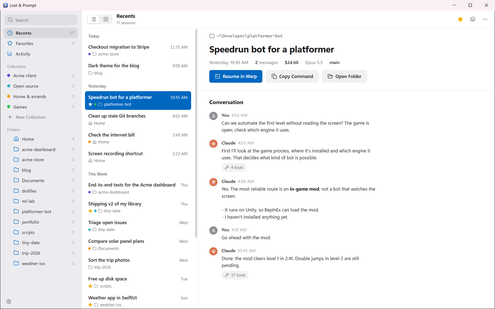
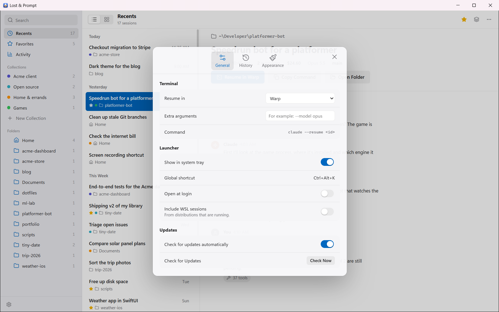
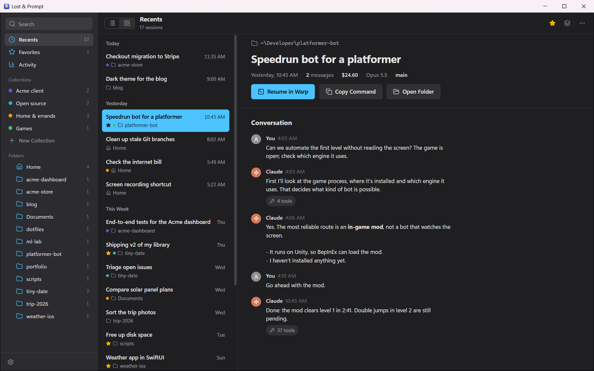

<p align="center">
  
</p>

<h1 align="center">Lost & Prompt</h1>

<p align="center"><b>Every Claude Code session you ever lost, found.</b><br>
All your Claude Code sessions, from every folder, in one place.</p>

<p align="center">
  <a href="https://github.com/axchisan/lost-and-prompt/releases/latest"></a>
  <a href="https://github.com/axchisan/lost-and-prompt/releases"></a>
  
  <a href="LICENSE"></a>
  <a href="https://github.com/axchisan/lost-and-prompt/actions/workflows/core.yml"></a>
</p>

<p align="center">
  <a href="#install"><b>Install</b></a> ·
  <a href="#features">Features</a> ·
  <a href="#faq">FAQ</a> ·
  <a href="https://lostandprompt.axchisan.com/">Website</a> ·
  <a href="README.md">Español</a>
</p>

---

Claude Code ties every session to the folder you opened it in, and `/resume` only lists the current
folder. Work across enough projects and you end up asking: *"which folder did I talk about this
in?"*

**Lost & Prompt** puts every session in one window. Find them by what was said, resume them in your
terminal with one click, and organize them your way. Free, open source, for **macOS, Windows and
Linux**.

<p align="center">
  
</p>

## Features

| | |
|---|---|
| **Find any session** | Every session from every folder, grouped by day. Search titles, folders and **the conversations themselves**, with the matching snippet highlighted. |
| **Find in a conversation** | ⌘F / Ctrl+F with a match counter and highlighting. Replies are formatted: code, tables, lists and headings. |
| **Resume in one click** | Opens the session in its original folder in your terminal: Warp, Terminal, iTerm2, Ghostty, Windows Terminal, PowerShell, GNOME Terminal, Konsole, Kitty, WezTerm… or anything else with a custom command. |
| **From any app** | A global shortcut (⌥⌘K on the Mac, Ctrl+Alt+K on Windows and Linux) opens quick search, and the menu bar / system tray icon lists your recent sessions. |
| **New session or your editor** | Start Claude Code in any session's folder (⌘N / Ctrl+N) or open it in VS Code, Cursor, Zed and more. |
| **Organize your way** | Favorites, custom names, collections and notes. None of it touches Claude Code's files. |
| **Read before you resume** | The conversation without the technical noise: your messages and Claude's replies. |
| **Activity** | Estimated cost, sessions and the folders you work in most. |
| **Keep your history** | Claude Code deletes sessions older than 30 days by default. Choose how long to keep them in Settings. |
| **WSL** | On Windows it also finds Claude Code sessions inside WSL. |
| **Updates itself** | On all three platforms, with signed updates. |

Rows or cards, light and dark mode, English and Spanish. The list updates live while you use Claude
Code.

| Cards | Quick search | Dark mode |
|---|---|---|
|  |  |  |

**On Windows**, the same design with Windows fonts and accent color:

| Main window | Settings | Dark mode |
|---|---|---|
|  |  |  |

## Install

| System | Quickest | Direct download |
|---|---|---|
| **macOS** 15+ | `brew install --cask axchisan/tap/lost-and-prompt` | [Universal `.dmg`](https://github.com/axchisan/lost-and-prompt/releases/latest) |
| **Windows** 10/11 | `scoop bucket add axchisan https://github.com/axchisan/scoop-bucket`<br>`scoop install axchisan/lost-and-prompt` | [`.exe`](https://github.com/axchisan/lost-and-prompt/releases/latest) |
| **Linux** x86_64 | [AppImage](https://github.com/axchisan/lost-and-prompt/releases/latest) (updates itself) | [`.deb`](https://github.com/axchisan/lost-and-prompt/releases/latest) · [`.rpm`](https://github.com/axchisan/lost-and-prompt/releases/latest) |

Coming soon: `winget install axchisan.LostAndPrompt` (in review in Microsoft's catalog) and AUR for
Arch Linux.

<details>
<summary><b>macOS: opening it the first time</b></summary>

Lost & Prompt isn't notarized by Apple (that requires a paid developer account), so the first time
macOS says it can't verify the developer. Open it once, then go to **System Settings → Privacy &
Security → Open Anyway**, or run:

```bash
xattr -dr com.apple.quarantine "/Applications/Lost & Prompt.app"
```

Homebrew does this for you.
</details>

<details>
<summary><b>Windows: the SmartScreen warning</b></summary>

The installer isn't signed with a paid certificate, so SmartScreen shows "Windows protected your
PC". Click **More info → Run anyway**. It installs for your user, no administrator needed. Scoop
skips the warning.
</details>

<details>
<summary><b>Linux: AppImage, Debian/Ubuntu or Fedora</b></summary>

```bash
# AppImage (any distribution; updates itself)
chmod +x LostAndPrompt-*-linux-x86_64.AppImage && ./LostAndPrompt-*-linux-x86_64.AppImage

# Debian, Ubuntu, Mint…
sudo apt install ./LostAndPrompt-*-linux-amd64.deb

# Fedora, openSUSE…
sudo dnf install ./LostAndPrompt-*-linux-x86_64.rpm
```
</details>

## Privacy

Lost & Prompt runs entirely on your computer:

- It **reads** Claude Code's sessions (`~/.claude/projects`, or `%USERPROFILE%\.claude\projects` on
  Windows) **without modifying them** and never sends them anywhere.
- Your organization (favorites, collections, notes) lives in the app's own file.
- The only Claude Code file it can change is `settings.json`, and only when you change the history
  setting; it backs the file up first.
- The only network request is the update check against GitHub Releases.

## FAQ

**Is this an official Anthropic app?**
No. It's an independent, open source project. Claude is a trademark of Anthropic, PBC.

**Does it work with every Claude Code version?**
It reads the session format Claude Code uses in 2026. The format is internal and may change; if a
new version breaks something, [open an issue](https://github.com/axchisan/lost-and-prompt/issues/new/choose).

**Why is it native on the Mac but not on Windows and Linux?**
On the Mac it's SwiftUI, so it feels like an Apple app. On Windows and Linux it's Tauri + Rust, with
the same design and the same logic, checked against the Mac version.

**How big is it?**
About 3 MB on the Mac, 4 MB on Windows and 8 MB on Linux (`.deb`). It reads 1 GB of sessions in
under a second.

**What if I delete a project folder?**
The session stays in the list. When you open it, the app tells you and lets you pick another folder
to resume it in.

## Build from source

<details>
<summary>Show instructions</summary>

**macOS app** (SwiftUI): macOS 15+, Xcode 26+ and [XcodeGen](https://github.com/yonaskolb/XcodeGen).

```bash
brew install xcodegen
xcodegen generate
open LostAndPrompt.xcodeproj
```

**Windows and Linux app** (Tauri 2 + Rust; also runs on macOS for development): Rust, Node 24 and
pnpm.

```bash
cd desktop
pnpm install
pnpm tauri dev
```

The shared Rust core lives in `core/` (`cargo test -p lost-and-prompt-core`). Releases are built
and published by GitHub Actions when a `vX.Y.Z` tag is pushed.
</details>

## Contributing

Contributions are welcome! Start with [CONTRIBUTING.md](CONTRIBUTING.md). Found a bug or have an
idea? [Open an issue](https://github.com/axchisan/lost-and-prompt/issues/new/choose) or join
[Discussions](https://github.com/axchisan/lost-and-prompt/discussions).

Roadmap, design notes and decisions (in Spanish) are in [`docs/`](docs/README.md).

If Lost & Prompt saves you time, **star the repo** so more people find it.

## License

[MIT](LICENSE) © 2026 axchisan. Lost & Prompt is an independent project, not affiliated with
Anthropic.
