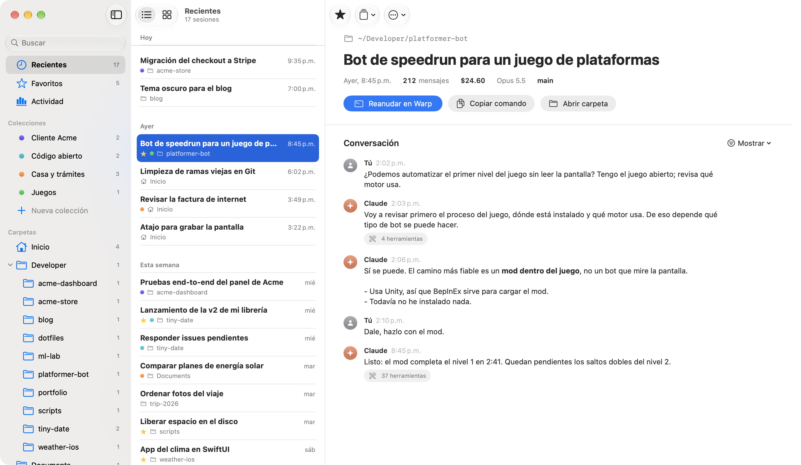
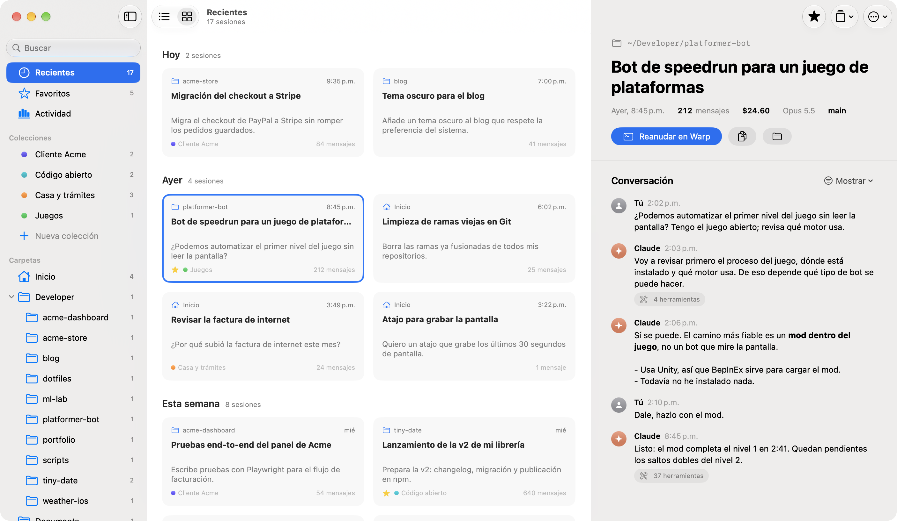
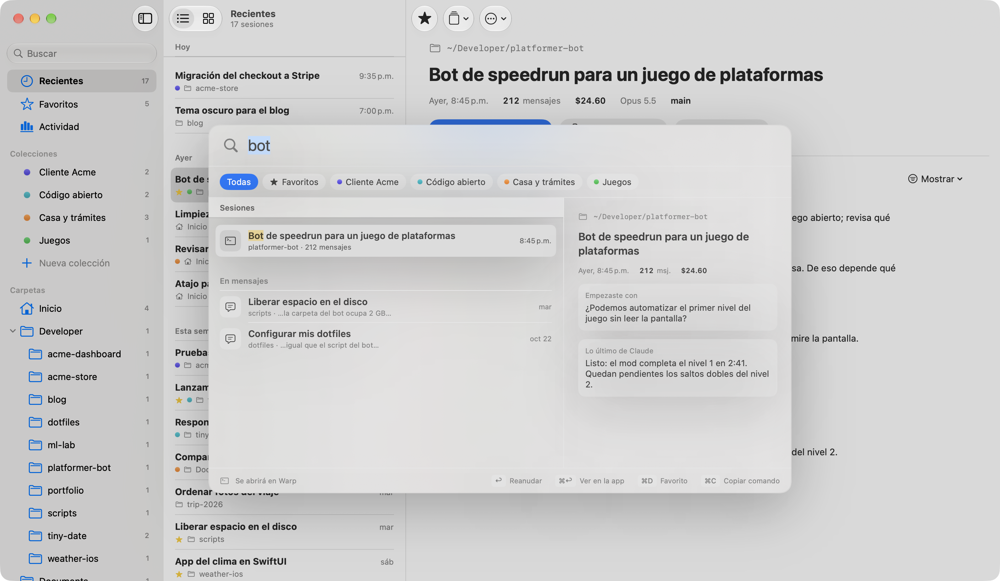
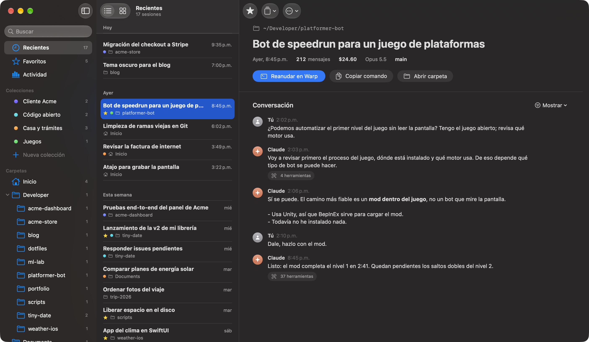
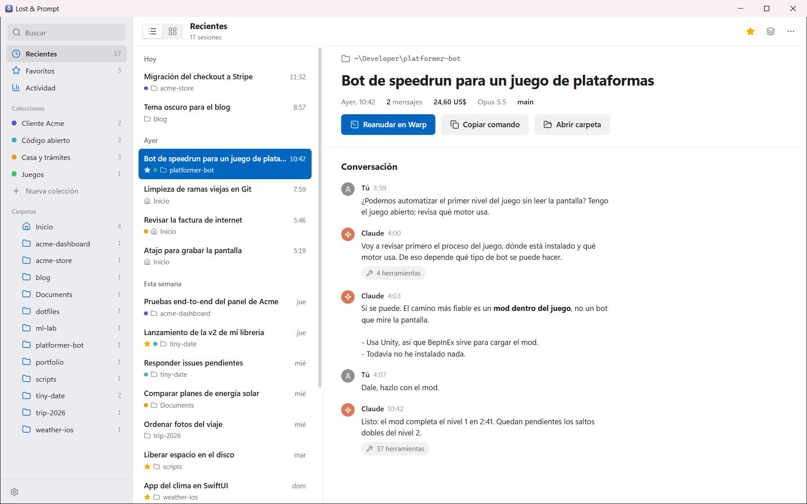
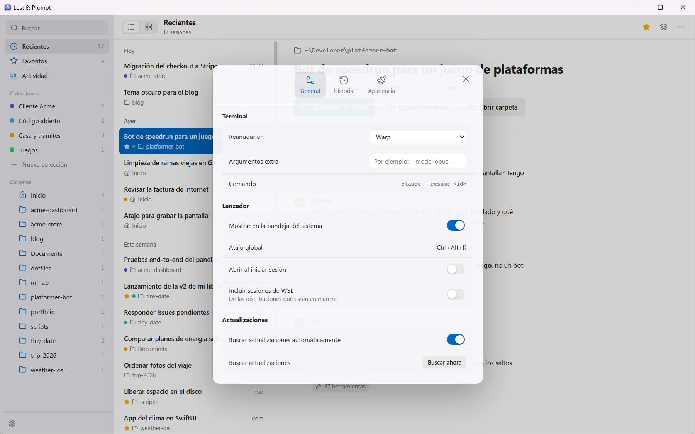
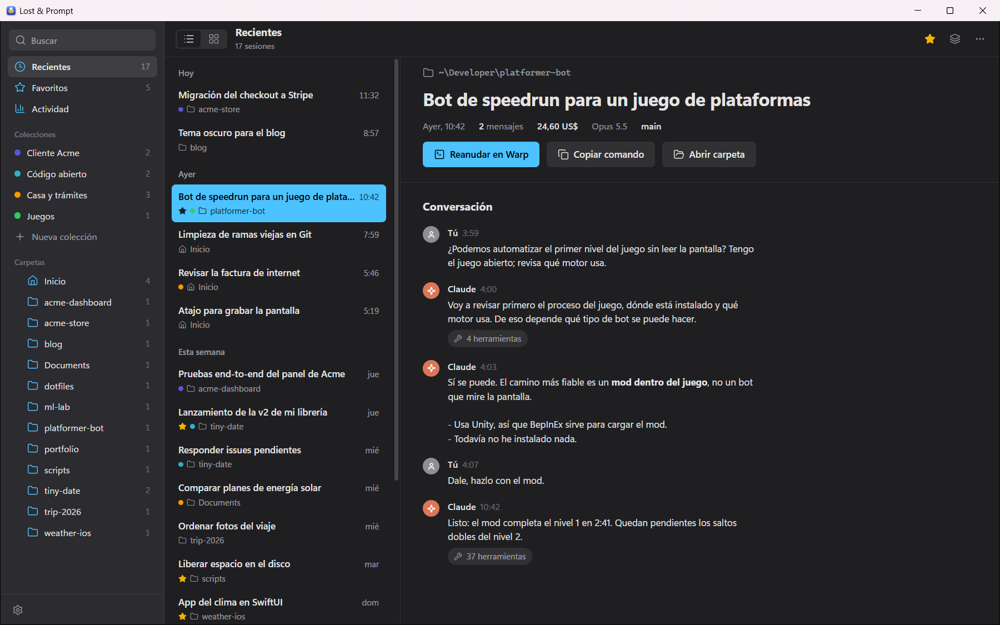

<p align="center">
  
</p>

<h1 align="center">Lost & Prompt</h1>

<p align="center"><b>Todas tus sesiones de Claude Code, de todas tus carpetas, en un solo lugar.</b><br>
<em>Every Claude Code session you ever lost, found.</em></p>

<p align="center">
  <a href="https://github.com/axchisan/lost-and-prompt/releases/latest"></a>
  <a href="https://github.com/axchisan/lost-and-prompt/releases"></a>
  
  <a href="LICENSE"></a>
  <a href="https://github.com/axchisan/lost-and-prompt/actions/workflows/core.yml"></a>
</p>

<p align="center">
  <a href="#instalación"><b>Instalar</b></a> ·
  <a href="#qué-hace">Qué hace</a> ·
  <a href="#preguntas-frecuentes">Preguntas frecuentes</a> ·
  <a href="https://lostandprompt.axchisan.com/">Sitio web</a> ·
  <a href="README.en.md">English</a>
</p>

---

Claude Code guarda cada sesión ligada a la carpeta donde la abriste, y `/resume` solo te muestra
las de la carpeta actual. Si trabajas en muchos proyectos, acabas preguntándote: *«¿en qué carpeta
hablé de esto?»*.

**Lost & Prompt** reúne todas tus sesiones en una sola ventana. Las buscas por lo que se dijo en
ellas, las reanudas en tu terminal con un clic y las organizas a tu manera. Es gratis, de código
abierto y funciona en **macOS, Windows y Linux**.

<p align="center">
  
</p>

## Qué hace

| | |
|---|---|
| **Encuentra cualquier sesión** | Todas las sesiones de todas las carpetas, agrupadas por día. Busca en los títulos, las carpetas y **dentro de las conversaciones**, con el fragmento resaltado. |
| **Busca dentro de la conversación** | ⌘F / Ctrl+F con contador y la coincidencia resaltada. Las respuestas se ven con formato: código, tablas, listas y títulos. |
| **Reanuda con un clic** | Abre la sesión en su carpeta original con tu terminal: Warp, Terminal, iTerm2, Ghostty, Windows Terminal, PowerShell, GNOME Terminal, Konsole, Kitty, WezTerm… o cualquier otra con un comando personalizado. |
| **Desde cualquier app** | Un atajo global (⌥⌘K en Mac, Ctrl+Alt+K en Windows y Linux) abre el buscador, y el ícono de la barra de menús o de la bandeja muestra tus sesiones recientes. |
| **Nueva sesión o tu editor** | Abre Claude Code en la carpeta de cualquier sesión (⌘N / Ctrl+N) o ábrela en VS Code, Cursor, Zed y otros. |
| **Organiza a tu manera** | Favoritos, nombres propios, colecciones y notas. Nada de esto toca los archivos de Claude Code. |
| **Lee antes de reanudar** | La conversación sin ruido técnico: tus mensajes y las respuestas de Claude. |
| **Actividad** | Costo estimado, sesiones y las carpetas en las que más trabajas. |
| **No pierdas tu historial** | Claude Code borra por defecto las sesiones de más de 30 días. Desde Ajustes eliges cuánto tiempo guardarlas. |
| **WSL** | En Windows también encuentra las sesiones de Claude Code dentro de WSL. |
| **Se actualiza sola** | En las tres plataformas, con actualizaciones firmadas. |

Filas o tarjetas, modo claro y oscuro, español e inglés. La lista se actualiza sola mientras usas
Claude Code.

| Tarjetas | Búsqueda rápida | Modo oscuro |
|---|---|---|
|  |  |  |

**En Windows**, el mismo diseño con la tipografía y el color de acento de Windows:

| Ventana principal | Ajustes | Modo oscuro |
|---|---|---|
|  |  |  |

## Instalación

| Sistema | La forma más rápida | Descarga directa |
|---|---|---|
| **macOS** 15+ | `brew install --cask axchisan/tap/lost-and-prompt` | [`.dmg` universal](https://github.com/axchisan/lost-and-prompt/releases/latest) |
| **Windows** 10/11 | `scoop bucket add axchisan https://github.com/axchisan/scoop-bucket`<br>`scoop install axchisan/lost-and-prompt` | [`.exe`](https://github.com/axchisan/lost-and-prompt/releases/latest) |
| **Linux** x86_64 | [AppImage](https://github.com/axchisan/lost-and-prompt/releases/latest) (se actualiza sola) | [`.deb`](https://github.com/axchisan/lost-and-prompt/releases/latest) · [`.rpm`](https://github.com/axchisan/lost-and-prompt/releases/latest) |

Pronto también con `winget install axchisan.LostAndPrompt` (en revisión en el catálogo de
Microsoft) y en AUR para Arch Linux.

<details>
<summary><b>macOS: la primera vez que la abres</b></summary>

Lost & Prompt no está notarizada por Apple, porque eso exige una cuenta de desarrollador de pago.
La primera vez, macOS dirá que no puede verificar al desarrollador. Ábrela una vez y ve a
**Ajustes del Sistema → Privacidad y seguridad → Abrir igualmente**, o ejecuta:

```bash
xattr -dr com.apple.quarantine "/Applications/Lost & Prompt.app"
```

Con Homebrew no hace falta: lo hace por ti.
</details>

<details>
<summary><b>Windows: el aviso de SmartScreen</b></summary>

El instalador no está firmado con un certificado de pago, así que SmartScreen mostrará
«Windows protegió su PC». Pulsa **Más información → Ejecutar de todas formas**. Se instala para tu
usuario, sin permisos de administrador. Con Scoop no aparece el aviso.
</details>

<details>
<summary><b>Linux: AppImage, Debian/Ubuntu o Fedora</b></summary>

```bash
# AppImage (cualquier distribución; se actualiza sola)
chmod +x LostAndPrompt-*-linux-x86_64.AppImage && ./LostAndPrompt-*-linux-x86_64.AppImage

# Debian, Ubuntu, Mint…
sudo apt install ./LostAndPrompt-*-linux-amd64.deb

# Fedora, openSUSE…
sudo dnf install ./LostAndPrompt-*-linux-x86_64.rpm
```
</details>

## Privacidad

Lost & Prompt funciona solo en tu equipo:

- **Lee** las sesiones de Claude Code (`~/.claude/projects`, o `%USERPROFILE%\.claude\projects` en
  Windows) **sin modificarlas** y no las envía a ningún sitio.
- Tu organización (favoritos, colecciones, notas) se guarda en un archivo propio de la app.
- El único archivo de Claude Code que puede cambiar es `settings.json`, y solo si tú cambias el
  plazo del historial; antes guarda una copia.
- La única conexión a internet es la que comprueba si hay versiones nuevas en GitHub.

## Preguntas frecuentes

**¿Es una app oficial de Anthropic?**
No. Es un proyecto independiente y de código abierto. Claude es una marca de Anthropic, PBC.

**¿Funciona con cualquier versión de Claude Code?**
Lee el formato de sesiones que Claude Code usa en 2026. El formato es interno y puede cambiar; si
una versión nueva rompe algo, [abre un issue](https://github.com/axchisan/lost-and-prompt/issues/new/choose).

**¿Por qué en Mac es nativa y en Windows y Linux no?**
En Mac está hecha en SwiftUI para que se sienta como una app de Apple. En Windows y Linux usa
Tauri y Rust, con el mismo diseño y la misma lógica, que se comprueba contra la versión de Mac.

**¿Cuánto ocupa?**
Unos 3 MB en Mac, 4 MB en Windows y 8 MB en Linux (`.deb`). Lee 1 GB de sesiones en menos de un
segundo.

**¿Qué pasa si borro una carpeta de proyecto?**
La sesión sigue en la lista. Al abrirla, la app te avisa y te deja elegir otra carpeta donde
reanudarla.

## Compilar desde el código

<details>
<summary>Ver instrucciones</summary>

**App de Mac** (SwiftUI): macOS 15+, Xcode 26+ y [XcodeGen](https://github.com/yonaskolb/XcodeGen).

```bash
brew install xcodegen
xcodegen generate
open LostAndPrompt.xcodeproj
```

**App de Windows y Linux** (Tauri 2 + Rust; también corre en macOS para desarrollar): Rust, Node 24
y pnpm.

```bash
cd desktop
pnpm install
pnpm tauri dev
```

El núcleo compartido en Rust está en `core/` (`cargo test -p lost-and-prompt-core`). Las versiones
las compila y publica GitHub Actions al subir una etiqueta `vX.Y.Z`.
</details>

## Contribuir

¡Las contribuciones son bienvenidas! Lee [CONTRIBUTING.md](CONTRIBUTING.md) para empezar. Si
encuentras un fallo o tienes una idea, [abre un issue](https://github.com/axchisan/lost-and-prompt/issues/new/choose)
o pasa por [Discussions](https://github.com/axchisan/lost-and-prompt/discussions).

La hoja de ruta, el diseño y las decisiones del proyecto están en [`docs/`](docs/README.md).

Si Lost & Prompt te ahorra tiempo, **dale una estrella al repositorio**: así llega a más gente.

## Licencia

[MIT](LICENSE) © 2026 axchisan. Lost & Prompt es un proyecto independiente, sin relación con
Anthropic.
