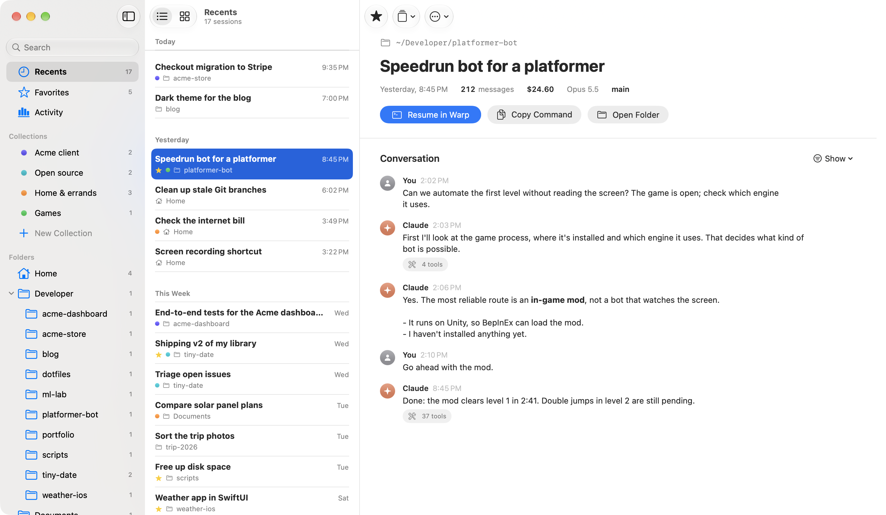

<p align="center">
  
</p>

<h1 align="center">Lost & Prompt</h1>

<p align="center"><em>Every Claude Code session you ever lost, found.</em></p>

<p align="center"><a href="README.es.md">Leer en español</a></p>

Lost & Prompt is an app for **macOS, Windows and Linux** to **find, organize and resume** all your
Claude Code sessions, no matter which folder you started them in. Native SwiftUI on the Mac;
Tauri + Rust on Windows and Linux, with the same design.

Claude Code ties every session to the directory it was opened in, and `/resume` only lists the
current folder by default. Once you work across many folders, remembering where you talked about
something gets hard. Lost & Prompt puts every session in one window.



## Features

- **Find**: every session from every folder, grouped by day. Search titles, folders and the
  conversations themselves, with the matching snippet highlighted.
- **Resume**: one click (or ↩) opens the session in its original folder, in your terminal: Warp,
  Terminal, iTerm2, Ghostty, Windows Terminal, PowerShell, GNOME Terminal, Konsole, Kitty,
  WezTerm… or any terminal with a custom command.
- **Quick search from anywhere**: ⌥⌘K on the Mac, Ctrl+Alt+K on Windows and Linux, plus a menu
  bar / system tray icon with your recent sessions.
- **WSL**: on Windows it also finds sessions from Claude Code inside WSL.
- **Organize**: favorites, custom names, collections and notes, without touching Claude Code's
  files.
- **Read**: the conversation without the technical noise, before you resume it.
- **Activity**: cost, sessions and most used folders.
- **Keep your history**: Claude Code deletes sessions older than 30 days by default. Choose how
  long to keep them from Settings.
- Rows or cards, light and dark mode, English and Spanish. Updates live while you use Claude Code.
- **Automatic updates** on all three platforms.

| Cards | Quick search | Dark mode |
|---|---|---|
|  |  |  |

## Install

Download from [Releases](https://github.com/axchisan/lost-and-prompt/releases/latest). Once
installed, Lost & Prompt updates itself.

### macOS

macOS 15 Sequoia or later, Apple Silicon or Intel.

```bash
brew install --cask axchisan/tap/lost-and-prompt
```

Or download `LostAndPrompt-<version>-macos-universal.dmg` and drag the app to Applications.

Lost & Prompt isn't notarized by Apple (that requires a paid developer account), so the first
time macOS says it can't verify the developer. Open it once, then go to **System Settings →
Privacy & Security → Open Anyway**, or run
`xattr -dr com.apple.quarantine "/Applications/Lost & Prompt.app"`. Homebrew does this for you.

### Windows

Windows 10 or 11 (x64). Download `LostAndPrompt-<version>-windows-x64-setup.exe` and run it; it
installs for your user, no administrator needed. The installer isn't code-signed, so SmartScreen
shows "Windows protected your PC": click **More info → Run anyway**.

### Linux

x86_64. Pick one:

```bash
# AppImage (updates itself)
chmod +x LostAndPrompt-*-linux-x86_64.AppImage && ./LostAndPrompt-*-linux-x86_64.AppImage

# Debian, Ubuntu, Mint…
sudo apt install ./LostAndPrompt-*-linux-amd64.deb

# Fedora, openSUSE…
sudo dnf install ./LostAndPrompt-*-linux-x86_64.rpm
```

## Privacy

Lost & Prompt runs entirely on your computer. It reads Claude Code's sessions (`~/.claude/projects`,
or `%USERPROFILE%\.claude\projects` on Windows) without modifying them and never sends them
anywhere; the only network request is the update check against GitHub Releases. The only Claude Code file it can change is
`~/.claude/settings.json`, and only when you change the history setting yourself; it backs the
file up first.

## Build from source

**macOS app** (SwiftUI): macOS 15+, Xcode 26+ and [XcodeGen](https://github.com/yonaskolb/XcodeGen).

```bash
brew install xcodegen
xcodegen generate
open LostAndPrompt.xcodeproj
```

**Windows and Linux app** (Tauri 2 + Rust, also runs on macOS for development): Rust, Node 24 and
pnpm.

```bash
cd desktop
pnpm install
pnpm tauri dev
```

The shared Rust core lives in `core/` (`cargo test -p lost-and-prompt-core`). Releases are built by
GitHub Actions when a `vX.Y.Z` tag is pushed (`scripts/bump-version.sh`). The design notes and decisions (in Spanish) are
in [`docs/`](docs/README.md).

## License

[MIT](LICENSE). Lost & Prompt is an independent project, not affiliated with Anthropic. Claude is
a trademark of Anthropic, PBC.
